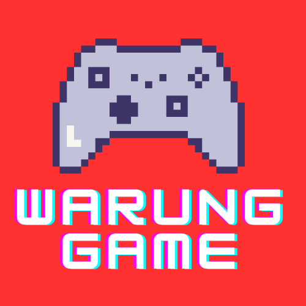

<div align="center">
  

  # Warung Game

  **Katalog dan toko game berbasis Laravel**

  Platform Warung Game memudahkan pelanggan menemukan dan melihat game digital melalui katalog produk, kategori, halaman detail, serta panel administrasi.
</div>

## Fitur

- Katalog game dengan cover dan harga produk
- Filter produk berdasarkan kategori
- Halaman detail untuk setiap game
- Tampilan grid responsif untuk desktop dan mobile
- Login akun pelanggan dengan Google
- Panel admin untuk mengelola kategori dan produk
- Status publikasi produk agar hanya produk aktif yang ditampilkan
- Keranjang belanja, akun pelanggan, dan lokasi toko

## Teknologi

- PHP 8.1 atau lebih baru
- Laravel 10
- MySQL / MariaDB
- Bootstrap
- jQuery
- Vite
- Blade Template

## Screenshot

Berikut tampilan utama Warung Game:


## Persyaratan

Pastikan perangkat memiliki:

- PHP 8.1+
- Composer
- Node.js dan npm
- MySQL atau MariaDB
- Extension PHP yang dibutuhkan oleh Laravel

## Cara Menjalankan Project

1. Masuk ke folder project:

   ```bash
   cd web-3
   ```

2. Install dependency PHP:

   ```bash
   composer install
   ```

3. Install dependency frontend:

   ```bash
   npm install
   ```

4. Buat file konfigurasi environment:

   ```bash
   cp .env.example .env
   ```

   Jika `.env.example` belum tersedia, buat `.env` dari template bawaan Laravel atau minta konfigurasi database dari administrator project.

5. Generate application key:

   ```bash
   php artisan key:generate
   ```

6. Sesuaikan koneksi database pada file `.env`:

   ```env
   DB_CONNECTION=mysql
   DB_HOST=127.0.0.1
   DB_PORT=3306
   DB_DATABASE=nama_database
   DB_USERNAME=nama_user
   DB_PASSWORD=password_database
   ```

7. Jalankan migration dan seeder:

   ```bash
   php artisan migrate --seed
   ```

8. Buat symbolic link storage:

   ```bash
   php artisan storage:link
   ```

9. Jalankan server aplikasi:

   ```bash
   php artisan serve
   ```

10. Buka project melalui:

   ```text
   http://127.0.0.1:8000
   ```

Untuk proses pengembangan frontend:

```bash
npm run dev
```

Untuk build asset production:

```bash
npm run build
```

## Login Admin

Panel administrasi dapat dibuka melalui:

```text
http://127.0.0.1:8000/backend/login
```

Gunakan akun admin yang dibuat melalui database seeder atau buat akun baru langsung dari database. Jangan menyimpan password admin atau nilai rahasia pada repository publik.

## Struktur Penting

- `app/Http/Controllers/BerandaController.php` — data halaman utama
- `app/Http/Controllers/ProdukController.php` — katalog, kategori, dan detail produk
- `app/Http/Controllers/LoginController.php` — login administrator
- `resources/views/v_beranda/index.blade.php` — tampilan grid utama
- `resources/views/v_produk/produkKategori.blade.php` — hasil filter kategori
- `resources/views/v_layouts/app.blade.php` — layout utama, navigasi, widget, dan footer
- `database/seeders/GameCatalogSeeder.php` — data game awal
- `public/image/wg.png` — logo Warung Game
- `public/frontend/img/game/` — cover produk frontend
- `public/storage/img-produk/` — thumbnail produk dari database

## Catatan Produk

- Produk hanya tampil di katalog publik jika memiliki `status = 1`.
- Produk baru umumnya dibuat dengan status `0` dan perlu dipublikasikan melalui admin.
- Setiap produk dapat dihubungkan dengan satu kategori.
- Cover produk disimpan sebagai file gambar dan thumbnail melalui kolom `foto`.

## Alur Pengembangan

1. Buat perubahan pada source code.
2. Pastikan perubahan aman:

   ```bash
   php artisan optimize:clear
   php artisan test
   ```

3. Tambahkan perubahan ke Git:

   ```bash
   git add .
   git commit -m "Update Warung Game project"
   git push
   ```

## Kontribusi

Kontribusi dapat dilakukan melalui branch baru dan Pull Request. Jangan commit file seperti `.env`, `vendor`, `node_modules`, `storage`, atau kredensial rahasia.

## Lisensi

Project ini dikembangkan untuk kebutuhan pembelajaran dan pengembangan Warung Game.
